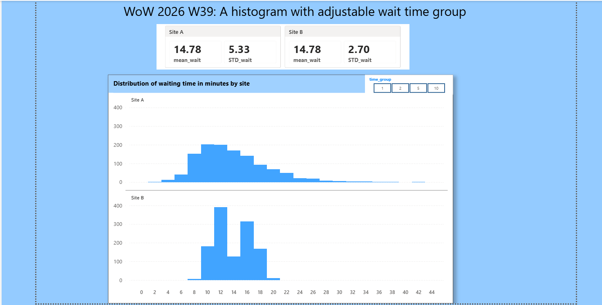
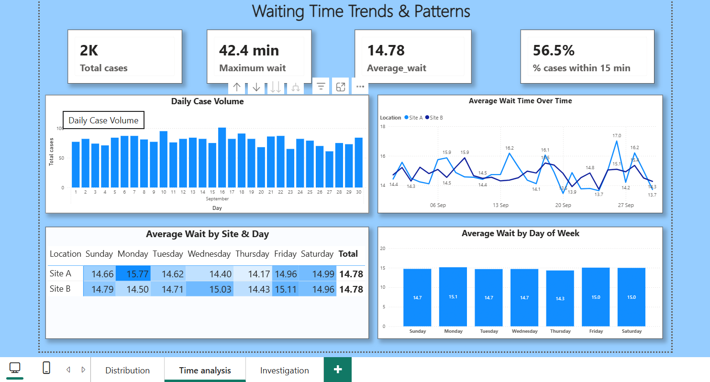
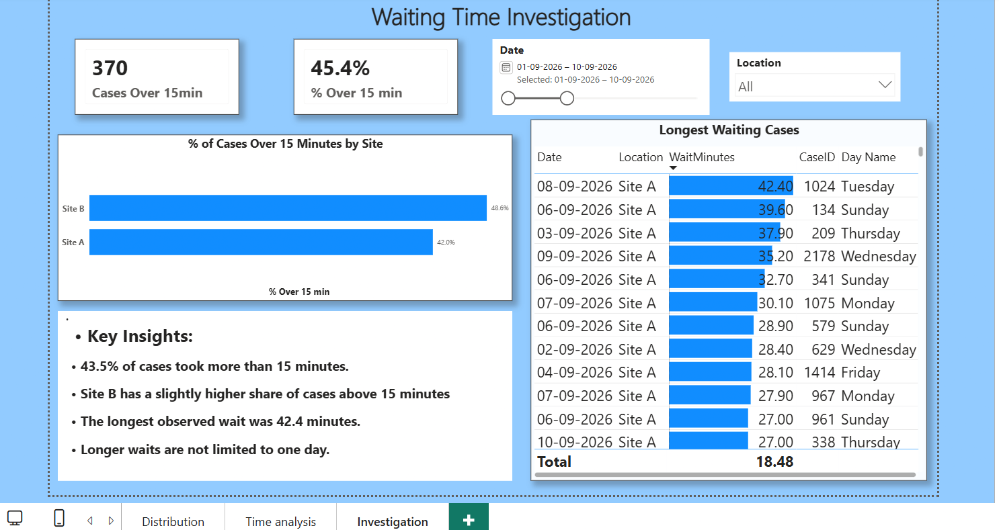

#  Patient Waiting Time Analysis – Video Demonstration

This documentation showcases my **Power BI Patient Waiting Time Analysis** project, inspired by **Workout Wednesday 2026 – Week 39**.

I extended the original adjustable histogram challenge into a three-page interactive dashboard to explore patient waiting-time distribution, trends, and areas requiring further investigation.

##  Dashboard Walkthrough

### 1. Waiting Time Distribution

**Business Question:** Do both clinic locations have similar waiting-time distributions despite having the same average?

 **[Watch LinkedIn Video Demonstration](https://lnkd.in/p/dDs5AcWy)**

### 2. Waiting Time Trends & Patterns

**Business Question:** When do waiting times vary, and are certain days associated with longer waits?

 **[Watch LinkedIn Video Demonstration](https://lnkd.in/p/dgYqUnZd)**

### 3. Waiting Time Investigation

##  My Key Learning

**The average gives us a number. Standard deviation tells us how much it varies. The histogram tells us the story behind those numbers.**

This project strengthened my ability to translate business questions into analytical solutions using Power BI.

---

**Tools:** Power BI Desktop | Power Query | DAX

**Challenge:** Workout Wednesday 2026 – Week 39

**[Connect with me on LinkedIn](https://www.linkedin.com/in/jayalalitha-t/)**
